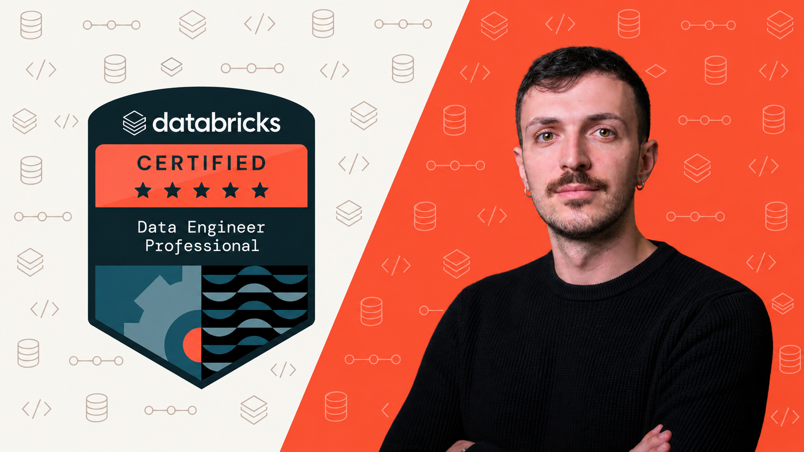

<div align="center">



# Databricks Data Engineer Professional: course code

**Hands-on notebooks, data generator, pipelines, jobs and bundle for the Professional certification**<br>
by [Fernando De Nitto](https://medium.com/@fernandodenitto)


</div>

This is the code for my Udemy course on the **Databricks Certified Data Engineer Professional** exam,
built against the guide of 9 October 2026: 60 scored questions, 120 minutes, nine sections. The exam
page may still show the previous version's numbers; the guide is what counts. The videos and quizzes
are on Udemy; the link goes here when the course is live. The notebooks also explain themselves, and
the reference cards stand alone.

It continues the **Lakeshore Outfitters** lakehouse from the
[Associate course](https://github.com/fernandodenitto/dbx-dea-prep-course-student), and takes it to
production: multiplex streaming, CDC, Lakeflow pipelines, testing, monitoring, compliance and
deployment. **You don't need the Associate course:** one setup notebook builds what you'd have had.

## Zero cost, zero cloud setup

Everything hands-on runs on **[Databricks Free Edition](https://www.databricks.com/learn/free-edition)**:
no credit card, no Azure, AWS or GCP account.

Free Edition has real limits. The Spark UI and cluster logs, classic compute, Lakeflow Connect database
connectors, OpenSharing, Clean Rooms and Data Classification can't run there. The exam asks about them,
so the course teaches them in full as labeled theory, and never fakes a demo.

## Start here

**1. Clone this repo as a Git folder**

1. In your workspace: **Workspace** → your home folder → **Create** → **Git folder**
2. Paste this repo's URL, provider **GitHub**. It's public, so no credentials are needed

Run every notebook from where it sits. Don't download single files or move them: notebooks walk up the
tree to find `datagen/`.

**2. Run the fast-forward**

Open `sections/01-welcome-method-fast-forward/01-04-fast-forward-setup`. It builds the baseline in catalog
`lakeshore`. Coming from the Associate course? Run it anyway: it creates only what's missing.

**3. Install the Databricks CLI.** Lesson 1.4 walks you through it. It's needed from Section 9 on.

**4. Follow the sections in order.** Every notebook runs on serverless compute.

## What's in here

```
datagen/          datagen.py (the dataset) and feed.py (the live feed)
sections/
├── 03-advanced-streaming/03-02-multiplex-bronze    a notebook, named after its lesson: 3.2
├── 03-advanced-streaming/03-07-*.md                a reference card: syntax and options
├── 08-production-pipelines/pipeline/               the Lakeflow pipeline's source
├── 08-production-pipelines/job/                    job definitions you can deploy
├── 09-monitoring-alerting/alert/                   the alert definition
└── 12-debugging-deploying/bundle/                  a real package and a deployable bundle
resources.md      every official doc link the lessons use, by section
```

| Section | You build or learn | Main exam section |
|---|---|---|
| 1 Welcome | The exam, the method, fast-forward, CLI | |
| 2 Data modeling | Dimensional models, SCD, MVs, metric views, Delta and Iceberg layouts | Data Modeling 5% |
| 3 Advanced streaming | Multiplex, quality, dedup, watermarks, SCD2 by hand | Developing Code 23% |
| 4 CDC, CDF, stream joins | Out-of-order CDC, Change Data Feed, stream joins, stateful semantics | Developing Code |
| 5 Python and SQL | Windows, UDFs, libraries, VARIANT, AI functions | Data Manipulation 12% |
| 6 Ingestion | Formats, Auto Loader, event buses, Lakeflow Connect, Iceberg | Ingestion 12% |
| 7 Cost and performance | Layout, deletion vectors, query profile, skew, caching | Cost & Performance 15% |
| 8 Production pipelines | Lakeflow pipelines, expectations, AUTO CDC, jobs, compute | Developing Code |
| 9 Monitoring | System tables, event logs, alerts, API and SDK, Spark UI | Monitoring 10% |
| 10 Security | Privileges, row filters, masks, ABAC, PII, data purging | Security 8% |
| 11 Governance and sharing | Tags, lineage, OpenSharing, Federation, Clean Rooms | Governance 5%, Ingestion |
| 12 Debugging and deploying | Tests, project structure, repair, API and CLI, bundles, Git CI/CD | Debugging 10% |
| 13 Exam strategy | Pacing, the official samples, a one-page recap, study resources | |

## Requirements

| | |
|---|---|
| **Workspace** | A [Free Edition](https://www.databricks.com/learn/free-edition) account |
| **From Section 9** | The [Databricks CLI](https://docs.databricks.com/aws/en/dev-tools/cli/install) and a configured profile |
| **Section 12, optional** | Python and a GitHub account, to run the tests locally and the CI sketch |

## If something goes wrong

- **Compute shut off for the day.** Free Edition has a daily quota, and heavy use can stop compute until the
  next day. See the [limits page](https://docs.databricks.com/aws/en/getting-started/free-edition-limitations).
  Pipelines and materialized views use the most, so don't run them all in one sitting.
- **`ModuleNotFoundError: datagen`.** The notebook isn't inside the Git folder. Clone the repo as above.
- **A streaming lab behaves differently the second time.** Checkpoints remember. Section 3 ships
  `reset-streaming-labs` to start those labs again.
- **Getting updates.** Use **Pull** in the Git folder dialog. It conflicts with any edits you made, so
  experiment in a copy of a notebook, or discard your changes first.

## Keep studying

- **[docs.databricks.com](https://docs.databricks.com/)** is the authority, always. Lessons link the pages they
  rely on, collected in [`resources.md`](resources.md).
- **[The current exam guide](https://www.databricks.com/sites/default/files/2026-10/Databricks-Certified-Data-Engineer-Professional-Exam-Guide-9-Oct-2026.pdf)**
  has the official outline and sample questions.
- **[Lakenaut](https://lakenaut.dev/)** is my free study site: one page per concept, a
  [roadmap for this exam](https://lakenaut.dev/roadmaps/de-professional/), and trackers for renames and previews.
  Handy as a second explanation; when it disagrees with the docs, the docs win. See the study reference card in
  Section 13.

---

<div align="center">

*Not affiliated with or endorsed by Databricks, Inc. Databricks and related names and marks are trademarks of their owners.*<br>
*This repository contains no exam questions.*<br>
*© Fernando De Nitto. Shared so you can follow the course and study. Please don't republish it.*

</div>
